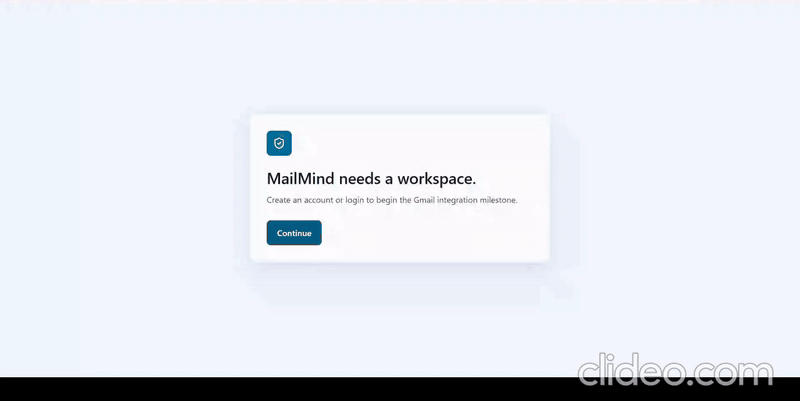
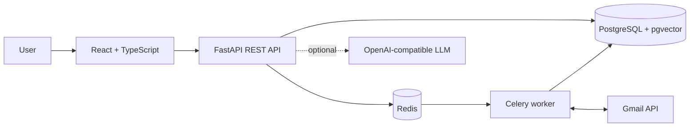

# MailMind

MailMind is an AI-assisted Gmail inbox manager. It connects a user-owned Gmail
account, syncs messages in the background, classifies and searches the inbox,
and suggests safe cleanup actions for user review. It does not automatically
delete email.

## Product Demo

<p align="center">
  
</p>

> [!IMPORTANT]
> **Full live walkthrough coming soon.** It will cover Gmail connection, background sync, AI classification, hybrid search, and safe cleanup review end to end.

## Proof Of Work

- **Frontend:** React, TypeScript, React Query, responsive dashboard and cleanup review.
- **Backend:** FastAPI, Pydantic validation, JWT authentication, SQLAlchemy and Alembic.
- **Data:** PostgreSQL + pgvector, idempotent Gmail persistence, full-text search.
- **Background jobs:** Redis and Celery for non-blocking Gmail sync and retries.
- **AI:** deterministic rules for obvious messages, structured LLM classification when configured, and a local fallback when it is unavailable.
- **Search:** PostgreSQL full-text + vector similarity, merged with Reciprocal Rank Fusion (RRF).

## Product Flow

1. Create a MailMind account and connect Gmail through OAuth.
2. The API creates a sync job; Celery imports messages in the background.
3. MailMind classifies inbox items, highlights high-priority attention items, and builds a searchable local inbox index.
4. The user searches, reviews recommendations, and explicitly confirms any Gmail cleanup action.

## Architecture



### Reliability Decisions

- Gmail sync jobs have explicit queued, running, retrying, succeeded, and failed states.
- `historyId` fetches incremental Gmail changes after the first sync.
- `UNIQUE(gmail_account_id, gmail_message_id)` plus upsert makes repeated syncs idempotent.
- Cleanup actions require explicit user review and have audit/undo support.

## AI And Search Without An API Key

MailMind works without an OpenAI key. The default pipeline is local and
deterministic:

```text
Email sender + subject + preview
            |
            v
Trusted security rules -> keyword/sender scoring -> local fallback
            |                    |
            v                    v
   Primary / High          category, priority, reply signal
            |
            v
PostgreSQL full-text + deterministic vector similarity -> RRF -> ranked search
```

- **Rules and keyword scoring:** fast, explainable triage for promotions,
  receipts, deadlines, interview requests, and trusted Google account-security
  alerts.
- **Security override:** a genuine Google account-security alert is classified
  as `Primary / High`; an unknown sender saying “security alert” is not trusted
  automatically.
- **Local fallback:** if no LLM key is configured, a lightweight local scorer
  still returns category, priority, reply signal, confidence, and rationale.
- **Hybrid retrieval:** PostgreSQL full-text handles exact terms, while local
  deterministic 64-dimensional vectors add similarity signals. Reciprocal Rank
  Fusion merges both ranked lists.
- **Optional LLM:** an OpenAI-compatible structured JSON classification stage
  runs only when the owner explicitly configures `OPENAI_API_KEY`.

The local vector approach is reproducible and free, but it is not a trained
semantic embedding model. A future fully local upgrade can use a bundled
sentence-transformer model when offline model storage and CPU/RAM budget are
acceptable.

## Deployment Status

- **Self-hosted:** supported now through Docker Compose; it is the stable,
  no-card option for a single machine or private installation.
- **Public SaaS:** requires an always-on host for FastAPI, Celery, Redis, and
  PostgreSQL. A Cloudflare Quick Tunnel is appropriate only for a short live
  demo because its URL and uptime depend on the local computer.

## Run Locally

### Developer Setup

```powershell
Copy-Item .env.example .env
docker compose up --build
```

Open `http://localhost:5173`. API docs are at `http://localhost:8000/docs`.

### Self-Hosted Setup

For a stable no-card installation on one computer, follow the
[self-hosted guide](docs/self-hosted.md). It starts the whole stack at
`http://localhost:8080` without Vercel or a Cloudflare Tunnel.

```powershell
Copy-Item .env.selfhosted.example .env.selfhosted
docker compose -f docker-compose.selfhosted.yml --env-file .env.selfhosted up --build -d
```

Each installation owns its Gmail credentials and local database. This is
self-hosted software, not a centrally hosted public SaaS.

## Verification

```powershell
# Backend tests
cd backend
pytest

# Frontend type-check and build
cd ../frontend
npm install
npm run lint
npm run build
```

The Gmail sync test suite verifies that a 500-message initial sync creates 500
records and a repeat sync creates no duplicates.

## Documentation

- [Architecture](docs/architecture.md)
- [API reference](docs/api.md)
- [Deployment guide](docs/deployment.md)
- [Self-hosted installation](docs/self-hosted.md)
- [Search benchmark](docs/search-benchmark.md)

