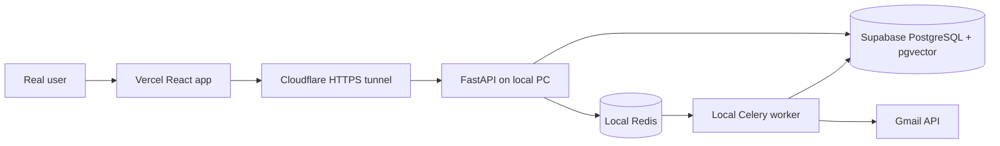

# No-Card Real-User Beta

This deployment path runs the public frontend on Vercel while a Windows PC runs the FastAPI API, Celery worker, and Redis. A Cloudflare Quick Tunnel gives the local API an HTTPS URL, and Supabase stores production data.

This is suitable for a controlled portfolio beta. It is not a 24/7 deployment: the API is available only while the PC, Docker Desktop, and tunnel are running, and a Quick Tunnel URL can change after restart.

## Architecture



## 1. Prerequisites

- Docker Desktop is running.
- The Vercel frontend is deployed.
- The Supabase project is active and the `vector` extension is enabled.
- For real Gmail testing: access to a Google OAuth web client with Gmail API enabled. It is not needed to assemble or demo-test the stack.
- The repository is up to date on the PC that will host the beta.

## 2. Create The Private Environment File

From the repository root:

```powershell
Copy-Item .env.beta.example .env.beta
```

Fill `.env.beta` with the real Supabase connection string, a random `SECRET_KEY`, Google client credentials, and the deployed Vercel origin. Keep `.env.beta` private; it is ignored by Git.

For this first real-user rollout, set `BETA_ALLOWED_EMAILS` to the comma-separated
email addresses of your invited testers. This keeps account creation private while
the Gmail OAuth application remains in Google's testing mode.

Generate a secret locally:

```powershell
python -c "import secrets; print(secrets.token_urlsafe(48))"
```

Use the complete Supabase **Session pooler** URL for `DATABASE_URL` (port `5432`) because FastAPI and Celery are long-running services. Copy it from **Supabase -> Connect -> Session pooler**; do not construct the host manually. URL-encode special characters in the password and keep `sslmode=require`.

## 3. Validate Configuration

From the repository root, validate values without printing secrets:

```powershell
.\.venv\Scripts\python.exe backend\scripts\check_beta_env.py
```

At this stage Google OAuth values may remain blank only if you are assembling a demo-only stack. Add `--require-oauth` before enabling real Gmail users:

```powershell
.\.venv\Scripts\python.exe backend\scripts\check_beta_env.py --require-oauth
```

The backend container runs `alembic upgrade head` automatically before FastAPI starts. After the stack is healthy, verify the actual database revision:

```powershell
docker compose -f docker-compose.beta.yml exec backend alembic current
```

The current revision should be `202609120012`.

## 4. Start The Beta Stack

The first start uses the placeholder redirect URL only to obtain the tunnel hostname:

```powershell
$env:MAILMIND_ENV_FILE='.env.beta'
docker compose -f docker-compose.beta.yml up --build -d
docker compose -f docker-compose.beta.yml ps
docker compose -f docker-compose.beta.yml logs tunnel
```

Find the generated URL ending in `.trycloudflare.com` in the tunnel logs. Do not stop or recreate the tunnel while configuring the remaining services, because a restart can generate a different URL.

## 5. Enable Gmail For Real Test Users

Set these values using the generated hostname:

```text
GOOGLE_REDIRECT_URI=https://YOUR-TUNNEL.trycloudflare.com/api/v1/gmail/oauth/callback
VITE_API_BASE_URL=https://YOUR-TUNNEL.trycloudflare.com/api/v1
```

Update `GOOGLE_REDIRECT_URI` in `.env.beta`, then confirm the full real-user configuration before continuing:

```powershell
.\.venv\Scripts\python.exe backend\scripts\check_beta_env.py --require-oauth
```

In Google Cloud Console, open **APIs & Services -> Credentials -> OAuth 2.0 Client ID** and add the exact URI as an authorized redirect URI. If the OAuth app is in testing mode, add every beta user under **OAuth consent screen -> Test users**.

In Vercel, set `VITE_API_BASE_URL` for Production and redeploy the frontend.

Restart only the API and worker so they load the updated environment without changing the tunnel URL:

```powershell
docker compose -f docker-compose.beta.yml up -d --force-recreate backend worker
```

## 6. Verify The Public API And Database

```powershell
docker compose -f docker-compose.beta.yml exec backend alembic current

$api='https://YOUR-TUNNEL.trycloudflare.com/api/v1'
Invoke-RestMethod "$api/health"
cd backend
..\.venv\Scripts\python.exe -m scripts.smoke_deployment --base-url $api
```

Then test the browser flow:

1. Sign up with a new MailMind account.
2. Log in and connect a Gmail test user.
3. Confirm OAuth returns to the dashboard.
4. Confirm the initial import moves from queued to running to succeeded.
5. Confirm additional pages continue automatically.
6. Run classification, search, inbox insights, and cleanup preview.
7. Apply archive or mark-read to a disposable test email, then verify undo.

## 7. Operations

Keep Docker Desktop and the PC awake while users are testing. Useful commands:

```powershell
docker compose -f docker-compose.beta.yml ps
docker compose -f docker-compose.beta.yml logs -f backend worker tunnel
docker compose -f docker-compose.beta.yml restart backend worker
docker compose -f docker-compose.beta.yml down
```

If the tunnel URL changes, update all three places before testing again:

1. `GOOGLE_REDIRECT_URI` in `.env.beta`.
2. Authorized redirect URI in Google Cloud.
3. `VITE_API_BASE_URL` in Vercel, followed by a redeploy.

## If Google Requires A Payment Card`n`nGoogle OAuth is mandatory only for real Gmail access. If Google prevents you from creating an OAuth client without card verification, do not add a card just for this beta. Keep the Vercel demo available and ask a college faculty member, mentor, or trusted collaborator to create the OAuth web client in a project they own. They can add this beta redirect URI and list approved testers, while the credentials remain only in your ignored `.env.beta`.`n`n## Safety Boundaries

- Keep cleanup review-first. MailMind must never bulk-delete automatically.
- Start with a dedicated Gmail test account and small batch size.
- Keep Google OAuth in testing mode for a controlled beta.
- Never commit Supabase passwords, OAuth secrets, JWT secrets, or real email exports.
- Rotate any secret that has been pasted into chat, logs, screenshots, or source control.
- Move to an always-on host and a named Cloudflare Tunnel before presenting this as general public production.
